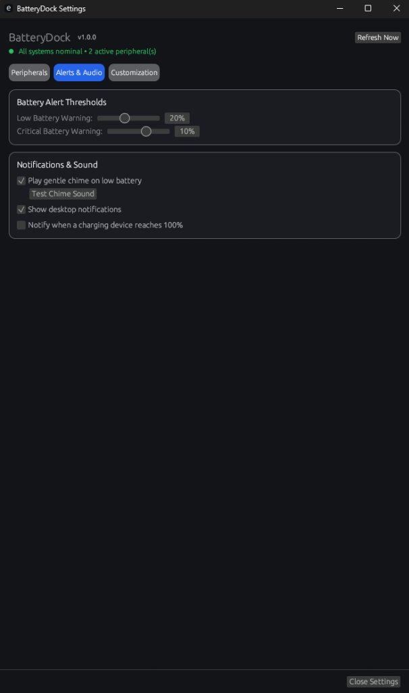

<div align="center">


# BatteryDock

**All your wireless peripheral batteries in one clean, native Windows taskbar pill. Zero vendor bloat.**

[](https://github.com/jorjanion/BatteryDock/stargazers)
[](https://github.com/jorjanion/BatteryDock/releases/latest)
[](https://github.com/jorjanion/BatteryDock/releases)
[](https://github.com/jorjanion/BatteryDock/actions)
[](LICENSE)
[](https://github.com/jorjanion/BatteryDock)
[](https://www.rust-lang.org/)

[Download v1.0.0](https://github.com/jorjanion/BatteryDock/releases/latest) · [Report a Bug](https://github.com/jorjanion/BatteryDock/issues/new) · [Request Device Support](https://github.com/jorjanion/BatteryDock/issues/new?template=device-support.md) · [Changelog](CHANGELOG.md)

<br />

<sub>
<b>English</b> ·
<a href="docs/i18n/README.es.md">Español</a> ·
<a href="docs/i18n/README.fr.md">Français</a> ·
<a href="docs/i18n/README.de.md">Deutsch</a> ·
<a href="docs/i18n/README.pt-BR.md">Português</a> ·
<a href="docs/i18n/README.it.md">Italiano</a> ·
<a href="docs/i18n/README.nl.md">Nederlands</a> ·
<a href="docs/i18n/README.pl.md">Polski</a> ·
<a href="docs/i18n/README.sv.md">Svenska</a> ·
<a href="docs/i18n/README.cs.md">Čeština</a> ·
<a href="docs/i18n/README.ru.md">Русский</a> ·
<a href="docs/i18n/README.uk.md">Українська</a> ·
<a href="docs/i18n/README.tr.md">Türkçe</a> ·
<a href="docs/i18n/README.ar.md">العربية</a> ·
<a href="docs/i18n/README.hi.md">हिन्दी</a> ·
<a href="docs/i18n/README.id.md">Bahasa Indonesia</a> ·
<a href="docs/i18n/README.vi.md">Tiếng Việt</a> ·
<a href="docs/i18n/README.ja.md">日本語</a> ·
<a href="docs/i18n/README.ko.md">한국어</a> ·
<a href="docs/i18n/README.zh-CN.md">简体中文</a> ·
<a href="docs/i18n/README.zh-TW.md">繁體中文</a>
</sub>

</div>

---

If you use a wireless mouse from one brand, a headset from another, and a Bluetooth controller or headphones on top, checking your battery levels on Windows usually means juggling three heavy background apps or digging into Windows Settings.

**BatteryDock** replaces all of that with a single ~4 MB native Rust app that sits quietly on your Windows 10/11 taskbar. No Electron, no telemetry, no accounts, and no manufacturer suites required.

---

## Preview

<div align="center">
  <table>
    <tr>
      <td align="center" valign="middle" width="50%">
        <br /><br />
        <sub><b>Single peripheral</b>: Clean vector icon, color-coded battery bar, and percentage right on the taskbar.</sub>
      </td>
      <td align="center" valign="middle" width="50%">
        <br /><br />
        <sub><b>Multiple peripherals side by side</b>: Reorder devices, rename them, or hide the ones you do not want to see.</sub>
      </td>
    </tr>
  </table>
  <br />
  <table>
    <tr>
      <td align="center" valign="top" width="33%">
        <br />
        <sub><b>Peripherals</b>: Live autonomy estimate, 24h battery sparkline, custom nicknames, and per-device alerts.</sub>
      </td>
      <td align="center" valign="top" width="33%">
        <br />
        <sub><b>Alerts & Audio</b>: Low, critical, and 100% full-charge notifications with a gentle chime preview.</sub>
      </td>
      <td align="center" valign="top" width="33%">
        <br />
        <sub><b>Customization</b>: Liquid Glass / Dark / Light / System themes, Gaming HUD overlay, hotkeys, and 21 languages.</sub>
      </td>
    </tr>
  </table>
</div>

---

## What It Does

### Minimalist Taskbar Pill
- **4 visual themes:** Choose between **Liquid Glass** (ultra-transparent), **Dark** (frosted acrylic), **Light** (frosted white acrylic), or **System** (automatically matches your Windows taskbar theme).
- **Zero clutter:** Left-click anywhere on the pill to open Settings, right-click for the quick menu, or drag it anywhere on any monitor.
- **Smart taskbar behavior:** Stays cleanly above the Windows taskbar even when opening Start, Search, or Widgets, and automatically hides during fullscreen videos and games.
- **Custom device layout:** Reorder peripherals on the pill with one click, give them custom nicknames, hide specific devices, or toggle percentage text on and off.

### Optional Gaming & Fullscreen HUD Overlay
- **Disabled by default** so fullscreen movies and YouTube stay completely unobstructed.
- When enabled, BatteryDock automatically pops into a screen corner during borderless/fullscreen games so your mouse or headset never dies mid-match.
- **Place it anywhere:** Pick from 4 corner presets with adjustable edge margin, or switch to Custom Position with X/Y sliders (0% to 100%) and live preview.
- **Click-through mode:** Mouse clicks pass straight through the HUD into your game.
- **Configurable global hotkey:** Bind any shortcut (default `Alt + B`, or any `Ctrl/Alt/Shift + key` / `F1` to `F12`) to show or hide the overlay on the fly without Alt-Tabbing.

### Smart Telemetry & Alerts
- **24-hour battery trend:** Each device card plots a lightweight local sparkline showing charge and discharge history.
- **Autonomy & sleep detection:** Estimates remaining battery life (or time to full charge) and detects idle/sleeping peripherals.
- **Low, critical, and 100% full-charge alerts:** Configure global or per-device thresholds, mute individual peripherals, play a gentle chime, and get native Windows desktop notifications even while the pill is hidden.

### 21 Languages Built In
- Automatically detects your Windows UI language on first launch and switches to it if supported, falling back to English otherwise.
- Native Windows system font fallbacks ensure crisp rendering across Latin, Cyrillic, Arabic, Devanagari, Japanese, Korean, and Simplified/Traditional Chinese scripts without extra downloads.

---

## Supported Hardware

BatteryDock talks directly to your hardware over HID, WinRT, and Bluetooth so you do not need vendor bloatware running in the background.

| Category | Protocol / Method | Supported Examples |
| :--- | :--- | :--- |
| **Logitech Wireless** | Direct HID++ 2.0 & G HUB IPC | Lightspeed headsets (G733, G535, G935, G435), mice (G PRO, Superlight, G502, MX Master), keyboards (G915) |
| **Razer Wireless** | Native Razer HyperSpeed HID | Viper, DeathAdder, Basilisk, Naga, Cobra, BlackWidow, Barracuda, BlackShark |
| **SteelSeries, Corsair & Glorious** | Native USB-HID | Arctis / Aerox / Rival, Corsair wireless mice & headsets, Glorious Model O / D |
| **HyperX & Astro Gaming** | Native Wireless Audio HID | HyperX Cloud II / III / Alpha / Flight / Stinger Wireless, Astro A50 / A30 |
| **Bluetooth Classic & BLE** | Windows PnP (`DEVPKEY_Bluetooth_Battery`) & BLE GATT | Sony WH/WF series (WH-1000XM4/XM5, WH-CH720N), JBL (Tune 770NC, Live), Bose, Sennheiser, AirPods, BT mice & keyboards |
| **Xbox Controllers** | XInput & Windows Gaming Input (WinRT) | Xbox Series X/S, Xbox One, Xbox Elite Series 2 |
| **PlayStation Controllers** | Direct Sony USB & Bluetooth HID | DualSense, DualSense Edge, DualShock 4 (USB, BT, & Wireless Adapter) |
| **Nintendo Controllers** | Direct Nintendo HID | Switch Pro Controller, Joy-Con L/R |

---

## Download & Installation

Get the latest version from the **[Releases page](https://github.com/jorjanion/BatteryDock/releases/latest)**:

1. Download **`BatteryDock-Setup-v1.0.0.exe`** (Windows installer), or **`BatteryDock-Windows-Portable.zip`** if you prefer a portable build with no installation.
2. Run it and optionally enable **Start BatteryDock when Windows boots** in Settings.
3. BatteryDock will appear on your taskbar next to the clock. Built-in GitHub auto-updates keep you up to date automatically (can be toggled off in Settings).

### Windows SmartScreen Note
Because BatteryDock is a free, open-source project without a paid code-signing certificate, Windows SmartScreen may show *"Windows protected your PC"* on first launch. Click **More info** and then **Run anyway**. Every release binary is compiled publicly from source on GitHub-hosted runners in [`.github/workflows/release.yml`](.github/workflows/release.yml), and you can inspect or build the code yourself at any time.

---

## Configuration

Settings are stored in a plain TOML file at `%APPDATA%\jorjanion\BatteryDock\config\config.toml` (and battery trend data in `history.toml` in the same folder). Everything can be adjusted live from the Settings window, and changes sync immediately without restarting.

---

## Build from Source

Requirements: Windows 10/11 and [Rust](https://rustup.rs/) (stable MSVC toolchain).

```powershell
git clone https://github.com/jorjanion/BatteryDock.git
cd BatteryDock
cargo test --locked
cargo build --release --locked
.\target\release\battery-dock.exe
```

---

## Contributing, Issues & Device Requests

BatteryDock is open source and community-driven. Contributions, bug reports, translations, and hardware support requests are always welcome.

- **Device not showing up?** Open a **[Device Support Request](https://github.com/jorjanion/BatteryDock/issues/new?template=device-support.md)**. To make it effortless, open **Settings > Customization > Copy Hardware Diagnostics** and paste the generated anonymized report straight into the issue (it includes only VID/PID/UsagePage and redacted Bluetooth PnP nodes, with zero serial numbers or MAC addresses).
- **Found a bug or have an idea?** Open an **[Issue](https://github.com/jorjanion/BatteryDock/issues)** with your Windows version and steps to reproduce.
- **Want to add a brand, protocol, or feature?** Pull requests are very welcome. Fork the repo, run `cargo test --locked` and `cargo clippy --locked`, and open a PR.

---

## License

MIT License. See [LICENSE](LICENSE) for details.
