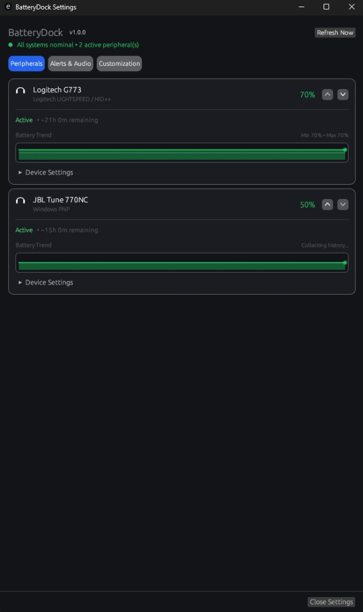

<div align="center">


# BatteryDock

**Todas las baterías de tus periféricos inalámbricos en una pastilla nativa y limpia en tu barra de tareas de Windows. Sin bloatware.**

[](https://github.com/jorjanion/BatteryDock/stargazers)
[](https://github.com/jorjanion/BatteryDock/releases/latest)
[](https://github.com/jorjanion/BatteryDock/releases)
[](https://github.com/jorjanion/BatteryDock/actions)
[](../../LICENSE)
[](https://github.com/jorjanion/BatteryDock)
[](https://www.rust-lang.org/)

[Descargar v1.0.0](https://github.com/jorjanion/BatteryDock/releases/latest) · [Reportar un error](https://github.com/jorjanion/BatteryDock/issues/new) · [Pedir soporte de dispositivo](https://github.com/jorjanion/BatteryDock/issues/new?template=device-support.md) · [Cambios](../../CHANGELOG.md)

<br />

<sub>
<a href="../../README.md">English</a> ·
<b>Español</b> ·
<a href="README.fr.md">Français</a> ·
<a href="README.de.md">Deutsch</a> ·
<a href="README.pt-BR.md">Português</a> ·
<a href="README.it.md">Italiano</a> ·
<a href="README.nl.md">Nederlands</a> ·
<a href="README.pl.md">Polski</a> ·
<a href="README.sv.md">Svenska</a> ·
<a href="README.cs.md">Čeština</a> ·
<a href="README.ru.md">Русский</a> ·
<a href="README.uk.md">Українська</a> ·
<a href="README.tr.md">Türkçe</a> ·
<a href="README.ar.md">العربية</a> ·
<a href="README.hi.md">हिन्दी</a> ·
<a href="README.id.md">Bahasa Indonesia</a> ·
<a href="README.vi.md">Tiếng Việt</a> ·
<a href="README.ja.md">日本語</a> ·
<a href="README.ko.md">한국어</a> ·
<a href="README.zh-CN.md">简体中文</a> ·
<a href="README.zh-TW.md">繁體中文</a>
</sub>

</div>

---

Si usas un ratón inalámbrico de una marca, auriculares de otra y un mando o cascos Bluetooth encima, ver cuánta batería queda en Windows suele implicar tener tres programas pesados en segundo plano o bucear en los ajustes de Windows.

**BatteryDock** sustituye todo eso por una sola app nativa en Rust de ~4 MB que vive discretamente en tu barra de tareas de Windows 10/11. Sin Electron, sin telemetría, sin cuentas y sin suites de fabricantes.

---

## Vista previa

<div align="center">
  <table>
    <tr>
      <td align="center" valign="middle" width="50%">
        <br /><br />
        <sub><b>Un periférico</b>: Icono vectorial nítido, barra de batería con colores y porcentaje directo en la barra de tareas.</sub>
      </td>
      <td align="center" valign="middle" width="50%">
        <br /><br />
        <sub><b>Varios periféricos a la vez</b>: Reordena tus dispositivos, cámbiales el nombre u oculta los que no quieras ver.</sub>
      </td>
    </tr>
  </table>
  <br />
  <table>
    <tr>
      <td align="center" valign="top" width="33%">
        <br />
        <sub><b>Periféricos</b>: Autonomía estimada en vivo, gráfica de historial de 24h, apodos y alertas individuales.</sub>
      </td>
      <td align="center" valign="top" width="33%">
        <br />
        <sub><b>Alertas y Audio</b>: Avisos de batería baja, crítica y carga completa al 100% con prueba de sonido.</sub>
      </td>
      <td align="center" valign="top" width="33%">
        <br />
        <sub><b>Personalización</b>: Temas Liquid Glass / Oscuro / Claro / Sistema, HUD para juegos, atajos y 21 idiomas.</sub>
      </td>
    </tr>
  </table>
</div>

---

## Qué hace

### Pastilla minimalista en la barra de tareas
- **4 temas visuales:** Elige entre **Liquid Glass** (ultratransparente), **Oscura** (acrílico oscuro), **Clara** (acrílico claro) o **Sistema** (sigue automáticamente el tema de tu barra de tareas de Windows).
- **Sin estorbos:** Haz clic izquierdo en cualquier parte de la pastilla para abrir Ajustes, clic derecho para el menú rápido o arrástrala a cualquier monitor.
- **Comportamiento inteligente:** Se mantiene siempre por encima de la barra de tareas incluso al abrir Inicio, Búsqueda o Widgets, y se oculta sola en vídeos y juegos a pantalla completa.
- **Diseño a tu medida:** Reordena tus periféricos con un clic, ponles apodos, oculta dispositivos concretos o muestra/oculta el porcentaje numérico.

### Overlay opcional para juegos y pantalla completa (HUD)
- **Desactivado por defecto** para que tus películas y YouTube a pantalla completa queden totalmente limpios.
- Al activarlo, BatteryDock salta automáticamente a una esquina durante juegos a pantalla completa sin bordes para que nunca te quedes sin batería en mitad de una partida.
- **Colócalo donde quieras:** Elige entre 4 esquinas rápidas con margen configurable o usa Posición libre con sliders X/Y (0% a 100%) y vista previa en vivo.
- **Modo Click-through:** Los clics del ratón atraviesan el HUD y van directos al juego.
- **Atajo de teclado global configurable:** Asigna cualquier combinación (por defecto `Alt + B`, o cualquier `Ctrl/Alt/Shift + tecla` / `F1` a `F12`) para mostrar u ocultar el overlay sin hacer Alt+Tab.

### Telemetría inteligente y alertas
- **Historial de batería de 24 horas:** Cada tarjeta incluye una mini gráfica local con la evolución de carga y descarga.
- **Autonomía y modo reposo:** Estima el tiempo restante de uso o de carga completa y detecta cuándo un periférico entra en reposo.
- **Alertas de batería baja, crítica y 100% cargada:** Configura umbrales globales o por dispositivo, silencia dispositivos concretos y recibe un sonido suave y notificaciones nativas de Windows incluso con la pastilla oculta.

### 21 idiomas integrados
- Detecta automáticamente el idioma de Windows al iniciar y lo aplica si está soportado (con inglés por defecto en caso contrario).
- Carga fuentes nativas del sistema de Windows bajo demanda para mostrar con nitidez alfabetos latino, cirílico, árabe, hindi, japonés, coreano y chino.

---

## Hardware compatible

BatteryDock se comunica directamente con tu hardware por HID, WinRT y Bluetooth para que no necesites software pesado del fabricante en segundo plano.

| Categoría | Protocolo / Método | Ejemplos compatibles |
| :--- | :--- | :--- |
| **Logitech Wireless** | Direct HID++ 2.0 & G HUB IPC | Lightspeed headsets (G733, G535, G935, G435), mice (G PRO, Superlight, G502, MX Master), keyboards (G915) |
| **Razer Wireless** | Native Razer HyperSpeed HID | Viper, DeathAdder, Basilisk, Naga, Cobra, BlackWidow, Barracuda, BlackShark |
| **SteelSeries, Corsair & Glorious** | Native USB-HID | Arctis / Aerox / Rival, Corsair wireless mice & headsets, Glorious Model O / D |
| **HyperX & Astro Gaming** | Native Wireless Audio HID | HyperX Cloud II / III / Alpha / Flight / Stinger Wireless, Astro A50 / A30 |
| **Bluetooth Classic & BLE** | Windows PnP (`DEVPKEY_Bluetooth_Battery`) & BLE GATT | Sony WH/WF series (WH-1000XM4/XM5, WH-CH720N), JBL (Tune 770NC, Live), Bose, Sennheiser, AirPods, BT mice & keyboards |
| **Xbox Controllers** | XInput & Windows Gaming Input (WinRT) | Xbox Series X/S, Xbox One, Xbox Elite Series 2 |
| **PlayStation Controllers** | Direct Sony USB & Bluetooth HID | DualSense, DualSense Edge, DualShock 4 (USB, BT, & Wireless Adapter) |
| **Nintendo Controllers** | Direct Nintendo HID | Switch Pro Controller, Joy-Con L/R |

---

## Descarga e instalación

Descarga la última versión desde la **[página de Releases](https://github.com/jorjanion/BatteryDock/releases/latest)**:

1. Descarga **`BatteryDock-Setup-v1.0.0.exe`** (instalador para Windows) o **`BatteryDock-Windows-Portable.zip`** si prefieres versión portable sin instalación.
2. Ejecútalo y, si quieres, activa **Iniciar BatteryDock con Windows** en Ajustes.
3. La pastilla aparecerá junto al reloj. Incluye actualizaciones automáticas desde GitHub (puedes desactivarlas en Ajustes).

### Nota sobre Windows SmartScreen
Al ser un proyecto gratuito y open source sin certificado de firma de pago, Windows SmartScreen puede mostrar *"Windows protegió su PC"* la primera vez. Haz clic en **Más información** y luego en **Ejecutar de todas formas**. Cada binario se compila públicamente en los runners de GitHub en [`.github/workflows/release.yml`](../../.github/workflows/release.yml), y puedes auditar o compilar el código tú mismo en cualquier momento.

---

## Configuración

Los ajustes se guardan en formato TOML en `%APPDATA%\jorjanion\BatteryDock\config\config.toml` (y el historial en `history.toml` en la misma carpeta). Todo se puede cambiar en vivo desde Ajustes sin reiniciar.

---

## Compilar desde el código fuente

Requisitos: Windows 10/11 y [Rust](https://rustup.rs/) (toolchain MSVC estable).

```powershell
git clone https://github.com/jorjanion/BatteryDock.git
cd BatteryDock
cargo test --locked
cargo build --release --locked
.\target\release\battery-dock.exe
```

---

## Contribuir, Issues y Pull Requests

BatteryDock es open source y crece gracias a la comunidad. Cualquier aporte, reporte de fallo, traducción o petición de hardware es más que bienvenido.

- **¿No aparece tu dispositivo?** Abre una **[petición de soporte de dispositivo](https://github.com/jorjanion/BatteryDock/issues/new?template=device-support.md)**. Para hacerlo facilísimo, entra en **Ajustes > Personalización > Copiar diagnóstico de hardware** y pega el informe anónimo en el issue (solo incluye VID/PID/UsagePage y nodos Bluetooth sin números de serie ni direcciones MAC).
- **¿Encontraste un fallo o tienes una idea?** Abre un **[Issue](https://github.com/jorjanion/BatteryDock/issues)** indicando tu versión de Windows y cómo reproducirlo.
- **¿Quieres añadir una marca, protocolo o función?** Las Pull Requests son bienvenidas. Haz fork del repositorio, ejecuta `cargo test --locked` y `cargo clippy --locked`, y abre tu PR.

---

## Licencia

Licencia MIT. Consulta [LICENSE](../../LICENSE) para más detalles.
