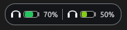

<div align="center">


# BatteryDock

**आपके सभी वायरलेस डिवाइस की बैटरी एक साफ, नेटिव Windows टास्कबार पिल में। बिना भारी वेंडर सॉफ्टवेयर के।**

[](https://github.com/jorjanion/BatteryDock/stargazers)
[](https://github.com/jorjanion/BatteryDock/releases/latest)
[](https://github.com/jorjanion/BatteryDock/releases)
[](https://github.com/jorjanion/BatteryDock/actions)
[](../../LICENSE)
[](https://github.com/jorjanion/BatteryDock)
[](https://www.rust-lang.org/)

[v1.0.0 डाउनलोड करें](https://github.com/jorjanion/BatteryDock/releases/latest) · [बग रिपोर्ट करें](https://github.com/jorjanion/BatteryDock/issues/new) · [डिवाइस सपोर्ट मांगें](https://github.com/jorjanion/BatteryDock/issues/new?template=device-support.md) · [चेंजलॉग](../../CHANGELOG.md)

<br />

<sub>
<a href="../../README.md">English</a> ·
<a href="README.es.md">Español</a> ·
<a href="README.fr.md">Français</a> ·
<a href="README.de.md">Deutsch</a> ·
<a href="README.pt-BR.md">Português</a> ·
<a href="README.it.md">Italiano</a> ·
<a href="README.nl.md">Nederlands</a> ·
<a href="README.pl.md">Polski</a> ·
<a href="README.sv.md">Svenska</a> ·
<a href="README.cs.md">Čeština</a> ·
<a href="README.ru.md">Русский</a> ·
<a href="README.uk.md">Українська</a> ·
<a href="README.tr.md">Türkçe</a> ·
<a href="README.ar.md">العربية</a> ·
<b>हिन्दी</b> ·
<a href="README.id.md">Bahasa Indonesia</a> ·
<a href="README.vi.md">Tiếng Việt</a> ·
<a href="README.ja.md">日本語</a> ·
<a href="README.ko.md">한국어</a> ·
<a href="README.zh-CN.md">简体中文</a> ·
<a href="README.zh-TW.md">繁體中文</a>
</sub>

</div>

---

यदि आप अलग-अलग ब्रांड के वायरलेस माउस, हेडसेट और ब्लूटूथ कंट्रोलर इस्तेमाल करते हैं, तो Windows पर बैटरी देखने के लिए अक्सर कई भारी बैकग्राउंड ऐप चलाने पड़ते हैं।

**BatteryDock** उन सभी को एक ~4 MB नेटिव Rust ऐप से बदल देता है जो आपके Windows 10/11 टास्कबार पर चुपचाप रहता है। न Electron, न टेलीमेट्री, न कोई अकाउंट।

---

## प्रीव्यू

<div align="center">
  <table>
    <tr>
      <td align="center" valign="middle" width="50%">
        <br /><br />
        <sub><b>एक डिवाइस</b>: साफ वेक्टर आइकन, रंगीन बैटरी बार और प्रतिशत सीधे टास्कबार पर।</sub>
      </td>
      <td align="center" valign="middle" width="50%">
        <br /><br />
        <sub><b>एक साथ कई डिवाइस</b>: डिवाइस का क्रम बदलें, नाम बदलें या अनावश्यक डिवाइस छिपाएं।</sub>
      </td>
    </tr>
  </table>
  <br />
  <table>
    <tr>
      <td align="center" valign="top" width="33%">
        <br />
        <sub><b>डिवाइस</b>: अनुमानित बैटरी समय, 24 घंटे का ग्राफ, कस्टम नाम और प्रति-डिवाइस अलर्ट।</sub>
      </td>
      <td align="center" valign="top" width="33%">
        <br />
        <sub><b>अलर्ट और ऑडियो</b>: कम, गंभीर और 100% फुल चार्ज सूचनाएं और ध्वनि परीक्षण।</sub>
      </td>
      <td align="center" valign="top" width="33%">
        <br />
        <sub><b>कस्टमाइज़ेशन</b>: Liquid Glass / डार्क / लाइट / सिस्टम थीम, गेमिंग HUD, शॉर्टकट और 21 भाषाएं।</sub>
      </td>
    </tr>
  </table>
</div>

---

## विशेषताएं

### मिनिमलिस्ट टास्कबार पिल
- **4 थीम:** **Liquid Glass** (पारदर्शी), **डार्क**, **लाइट**, या **सिस्टम** (Windows थीम अपने आप अपनाता है)।
- **सरल नियंत्रण:** लेफ्ट क्लिक से सेटिंग्स खुलती हैं, राइट क्लिक से क्विक मेनू, या इसे किसी भी मॉनिटर पर खींचें।
- **स्मार्ट व्यवहार:** Start या Search खोलने पर भी दिखाई देता है और फुलस्क्रीन वीडियो व गेम्स में अपने आप छिप जाता है।
- **कस्टम लेआउट:** एक क्लिक में डिवाइस क्रम बदलें, उपनाम दें, डिवाइस छिपाएं या प्रतिशत टेक्स्ट टॉगल करें।

### वैकल्पिक गेमिंग और फुलस्क्रीन ओवरले (HUD)
- **डिफ़ॉल्ट रूप से बंद** ताकि फुलस्क्रीन वीडियो और YouTube बिना रुकावट चलें।
- चालू करने पर बॉर्डरलेस फुलस्क्रीन गेम्स के दौरान स्क्रीन के कोने में बैटरी दिखती है।
- **कहीं भी रखें:** एडजस्टेबल मार्जिन वाले 4 कोने या लाइव प्रीव्यू के साथ X/Y (0% से 100%) कस्टम स्थिति।
- **Click-through मोड:** माउस क्लिक सीधे गेम में जाते हैं।
- **ग्लोबल शॉर्टकट:** Alt+Tab किए बिना ओवरले दिखाने/छिपाने के लिए कोई भी कुंजी सेट करें (डिफ़ॉल्ट `Alt + B`)।

### स्मार्ट टेलीमेट्री और अलर्ट
- **24 घंटे का बैटरी ट्रेंड:** हर डिवाइस कार्ड पर चार्ज और डिस्चार्ज का हल्का लोकल ग्राफ दिखता है।
- **बैकअप समय और स्लीप मोड:** शेष समय या फुल चार्ज समय का अनुमान लगाता है और स्लीप डिवाइस पहचानता है।
- **कम, गंभीर और 100% चार्ज अलर्ट:** ग्लोबल या प्रति-डिवाइस सीमा, म्यूट विकल्प, हल्की ध्वनि और Windows नोटिफिकेशन।

### 21 भाषाएं बिल्ट-इन
- पहली बार चलने पर Windows भाषा अपने आप पहचानता है (असमर्थित होने पर English)।
- सभी लिपियों को स्पष्ट दिखाने के लिए जरूरत पर Windows के नेटिव फॉन्ट लोड करता है।

---

## समर्थित हार्डवेयर

BatteryDock बिना वेंडर सॉफ्टवेयर के HID, WinRT और Bluetooth से सीधे हार्डवेयर पढ़ता है।

| श्रेणी | प्रोटोकॉल / तरीका | समर्थित उदाहरण |
| :--- | :--- | :--- |
| **Logitech Wireless** | Direct HID++ 2.0 & G HUB IPC | Lightspeed headsets (G733, G535, G935, G435), mice (G PRO, Superlight, G502, MX Master), keyboards (G915) |
| **Razer Wireless** | Native Razer HyperSpeed HID | Viper, DeathAdder, Basilisk, Naga, Cobra, BlackWidow, Barracuda, BlackShark |
| **SteelSeries, Corsair & Glorious** | Native USB-HID | Arctis / Aerox / Rival, Corsair wireless mice & headsets, Glorious Model O / D |
| **HyperX & Astro Gaming** | Native Wireless Audio HID | HyperX Cloud II / III / Alpha / Flight / Stinger Wireless, Astro A50 / A30 |
| **Bluetooth Classic & BLE** | Windows PnP (`DEVPKEY_Bluetooth_Battery`) & BLE GATT | Sony WH/WF series (WH-1000XM4/XM5, WH-CH720N), JBL (Tune 770NC, Live), Bose, Sennheiser, AirPods, BT mice & keyboards |
| **Xbox Controllers** | XInput & Windows Gaming Input (WinRT) | Xbox Series X/S, Xbox One, Xbox Elite Series 2 |
| **PlayStation Controllers** | Direct Sony USB & Bluetooth HID | DualSense, DualSense Edge, DualShock 4 (USB, BT, & Wireless Adapter) |
| **Nintendo Controllers** | Direct Nintendo HID | Switch Pro Controller, Joy-Con L/R |

---

## डाउनलोड और इंस्टॉलेशन

**[Releases पेज](https://github.com/jorjanion/BatteryDock/releases/latest)** से नवीनतम संस्करण लें:

1. **`BatteryDock-Setup-v1.0.0.exe`** (इंस्टॉलर) या **`BatteryDock-Windows-Portable.zip`** (पोर्टेबल) डाउनलोड करें।
2. इसे चलाएं और चाहें तो सेटिंग्स में Windows स्टार्टअप चालू करें।
3. यह घड़ी के पास दिखाई देगा और GitHub से ऑटो-अपडेट सपोर्ट करता है।

### Windows SmartScreen नोट
यह एक मुफ्त ओपन-सोर्स ऐप है जिसमें पेड सर्टिफिकेट नहीं है, इसलिए पहली बार SmartScreen चेतावनी दिख सकती है। **More info** और फिर **Run anyway** पर क्लिक करें। सभी बिल्ड [`.github/workflows/release.yml`](../../.github/workflows/release.yml) में सार्वजनिक रूप से बनते हैं।

---

## कॉन्फ़िगरेशन

सेटिंग्स `%APPDATA%\jorjanion\BatteryDock\config\config.toml` (और इतिहास `history.toml`) में सेव होती हैं और तुरंत लागू होती हैं।

---

## सोर्स से बिल्ड करें

आवश्यकताएं: Windows 10/11 और [Rust](https://rustup.rs/) (स्थिर MSVC)।

```powershell
git clone https://github.com/jorjanion/BatteryDock.git
cd BatteryDock
cargo test --locked
cargo build --release --locked
.\target\release\battery-dock.exe
```

---

## योगदान, Issues और Pull Requests

BatteryDock ओपन सोर्स है। बग रिपोर्ट, अनुवाद, नए डिवाइस अनुरोध और PR का हमेशा स्वागत है।

- **डिवाइस नहीं दिख रहा?** **[डिवाइस सपोर्ट अनुरोध](https://github.com/jorjanion/BatteryDock/issues/new?template=device-support.md)** खोलें। **सेटिंग्स > कस्टमाइज़ेशन > हार्डवेयर डायग्नोस्टिक्स कॉपी करें** पर क्लिक करें और रिपोर्ट पेस्ट करें।
- **कोई बग या सुझाव?** अपने Windows संस्करण के साथ **[Issue](https://github.com/jorjanion/BatteryDock/issues)** खोलें।
- **कोड जोड़ना चाहते हैं?** Pull Requests का स्वागत है। PR से पहले `cargo test --locked` और `cargo clippy --locked` चलाएं।

---

## लाइसेंस

MIT लाइसेंस। विवरण के लिए [LICENSE](../../LICENSE) देखें।
