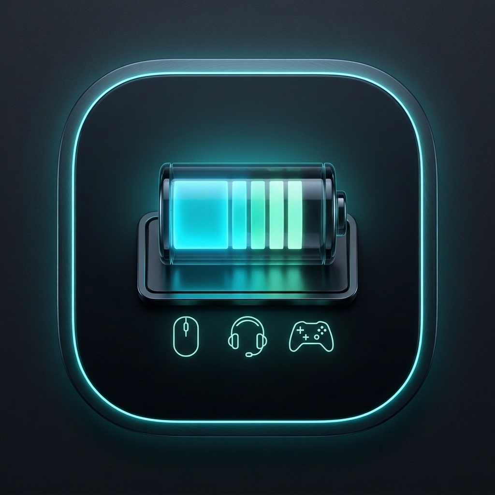

<div align="center">



# BatteryDock

**Tutte le batterie delle tue periferiche wireless in una barra nativa su Windows. Zero software pesanti dei produttori.**

[](https://github.com/jorjanion/BatteryDock/stargazers)
[](https://github.com/jorjanion/BatteryDock/releases/latest)
[](https://github.com/jorjanion/BatteryDock/releases)
[](https://github.com/jorjanion/BatteryDock/actions)
[](../../LICENSE)
[](https://github.com/jorjanion/BatteryDock)
[](https://www.rust-lang.org/)

[Scarica v1.0.0](https://github.com/jorjanion/BatteryDock/releases/latest) · [Segnala un bug](https://github.com/jorjanion/BatteryDock/issues/new) · [Richiedi supporto dispositivo](https://github.com/jorjanion/BatteryDock/issues/new?template=device-support.md) · [Changelog](../../CHANGELOG.md)

<br />

<sub>
<a href="../../README.md">English</a> ·
<a href="README.es.md">Español</a> ·
<a href="README.fr.md">Français</a> ·
<a href="README.de.md">Deutsch</a> ·
<a href="README.pt-BR.md">Português</a> ·
<b>Italiano</b> ·
<a href="README.nl.md">Nederlands</a> ·
<a href="README.pl.md">Polski</a> ·
<a href="README.sv.md">Svenska</a> ·
<a href="README.cs.md">Čeština</a> ·
<a href="README.ru.md">Русский</a> ·
<a href="README.uk.md">Українська</a> ·
<a href="README.tr.md">Türkçe</a> ·
<a href="README.ar.md">العربية</a> ·
<a href="README.hi.md">हिन्दी</a> ·
<a href="README.id.md">Bahasa Indonesia</a> ·
<a href="README.vi.md">Tiếng Việt</a> ·
<a href="README.ja.md">日本語</a> ·
<a href="README.ko.md">한국어</a> ·
<a href="README.zh-CN.md">简体中文</a> ·
<a href="README.zh-TW.md">繁體中文</a>
</sub>

</div>

---

Se usi un mouse wireless di un marchio, cuffie di un altro e un controller Bluetooth, controllare la batteria su Windows spesso significa tenere aperti programmi pesanti in background.

**BatteryDock** sostituisce tutto con un'unica app nativa in Rust da ~4 MB integrata nella barra delle applicazioni di Windows 10/11. Niente Electron, niente telemetria, niente account.

---

## Anteprima

<div align="center">
  <table>
    <tr>
      <td align="center" valign="middle" width="50%">
        <br /><br />
        <sub><b>Singola periferica</b>: Icona vettoriale nitida, barra colorata e percentuale nella barra delle applicazioni.</sub>
      </td>
      <td align="center" valign="middle" width="50%">
        <br /><br />
        <sub><b>Più periferiche</b>: Riordina i dispositivi, rinominali o nascondi quelli che non ti servono.</sub>
      </td>
    </tr>
  </table>
  <br />
  <table>
    <tr>
      <td align="center" valign="top" width="33%">
        <br />
        <sub><b>Periferiche</b>: Autonomia stimata, grafico 24h, nomi personalizzati e avvisi per dispositivo.</sub>
      </td>
      <td align="center" valign="top" width="33%">
        <br />
        <sub><b>Avvisi e Audio</b>: Notifiche per batteria scarica, critica e carica al 100% con prova audio.</sub>
      </td>
      <td align="center" valign="top" width="33%">
        <br />
        <sub><b>Personalizzazione</b>: Temi Liquid Glass / Scuro / Chiaro / Sistema, HUD giochi, scorciatoia e 21 lingue.</sub>
      </td>
    </tr>
  </table>
</div>

---

## Funzionalità

### Barra minimalista nella taskbar
- **4 temi visivi:** Scegli tra **Liquid Glass** (ultratrasparente), **Scuro**, **Chiaro** o **Sistema** (segue il tema di Windows).
- **Nessun ingombro:** Clic sinistro per aprire le Impostazioni, clic destro per il menu rapido, oppure trascinala su qualsiasi monitor.
- **Comportamento intelligente:** Resta sopra la barra delle applicazioni anche con Start o Ricerca aperti e si nasconde nei video e giochi a schermo intero.
- **Layout su misura:** Riordina i dispositivi con un clic, assegna soprannomi, nascondi periferiche o attiva/disattiva la percentuale.

### Overlay opzionale per giochi e schermo intero (HUD)
- **Disattivato di default** per non disturbare film o YouTube a schermo intero.
- Quando attivo, compare in un angolo dello schermo durante i giochi a schermo intero senza bordi.
- **Ovunque sullo schermo:** 4 angoli con margine regolabile oppure posizione libera X/Y (0% - 100%) con anteprima dal vivo.
- **Modalità Click-through:** I clic del mouse attraversano l'HUD direttamente nel gioco.
- **Scorciatoia globale configurabile:** Imposta qualsiasi combinazione (default `Alt + B`) per mostrare o nascondere l'overlay senza Alt+Tab.

### Telemetria intelligente e avvisi
- **Cronologia di 24 ore:** Ogni scheda mostra un grafico leggero con l'andamento di carica e scarica.
- **Autonomia e sospensione:** Stima il tempo residuo o alla carica completa e rileva lo stato di standby.
- **Avvisi scarica, critica e 100%:** Soglie globali o per dispositivo, silenziamento singolo, suono discreto e notifiche native Windows.

### 21 lingue integrate
- Rileva automaticamente la lingua di Windows al primo avvio (con inglese come fallback).
- Carica i font nativi di Windows su richiesta per una resa perfetta in ogni alfabeto.

---

## Hardware supportato

BatteryDock legge direttamente i dispositivi via HID, WinRT e Bluetooth senza suite dei produttori.

| Categoria | Protocollo / Metodo | Esempi supportati |
| :--- | :--- | :--- |
| **Logitech Wireless** | Direct HID++ 2.0 & G HUB IPC | Lightspeed headsets (G733, G535, G935, G435), mice (G PRO, Superlight, G502, MX Master), keyboards (G915) |
| **Razer Wireless** | Native Razer HyperSpeed HID | Viper, DeathAdder, Basilisk, Naga, Cobra, BlackWidow, Barracuda, BlackShark |
| **SteelSeries, Corsair & Glorious** | Native USB-HID | Arctis / Aerox / Rival, Corsair wireless mice & headsets, Glorious Model O / D |
| **HyperX & Astro Gaming** | Native Wireless Audio HID | HyperX Cloud II / III / Alpha / Flight / Stinger Wireless, Astro A50 / A30 |
| **Bluetooth Classic & BLE** | Windows PnP (`DEVPKEY_Bluetooth_Battery`) & BLE GATT | Sony WH/WF series (WH-1000XM4/XM5, WH-CH720N), JBL (Tune 770NC, Live), Bose, Sennheiser, AirPods, BT mice & keyboards |
| **Xbox Controllers** | XInput & Windows Gaming Input (WinRT) | Xbox Series X/S, Xbox One, Xbox Elite Series 2 |
| **PlayStation Controllers** | Direct Sony USB & Bluetooth HID | DualSense, DualSense Edge, DualShock 4 (USB, BT, & Wireless Adapter) |
| **Nintendo Controllers** | Direct Nintendo HID | Switch Pro Controller, Joy-Con L/R |

---

## Download e installazione

Scarica l'ultima versione dalla **[pagina Releases](https://github.com/jorjanion/BatteryDock/releases/latest)**:

1. Scarica **`BatteryDock-Setup-v1.0.0.exe`** (installer Windows) oppure **`BatteryDock-Windows-Portable.zip`** (portatile).
2. Avvialo e abilita eventualmente l'avvio automatico con Windows nelle impostazioni.
3. Apparirà accanto all'orologio con aggiornamenti automatici da GitHub.

### Nota su Windows SmartScreen
Essendo un progetto open source gratuito senza certificato a pagamento, SmartScreen potrebbe mostrare un avviso al primo avvio. Fai clic su **Ulteriori informazioni** e **Esegui comunque**. I binari sono compilati pubblicamente in [`.github/workflows/release.yml`](../../.github/workflows/release.yml).

---

## Configurazione

Le impostazioni sono salvate in `%APPDATA%\jorjanion\BatteryDock\config\config.toml` (e la cronologia in `history.toml`) con sincronizzazione istantanea.

---

## Compilazione da sorgente

Requisiti: Windows 10/11 e [Rust](https://rustup.rs/) (toolchain MSVC stabile).

```powershell
git clone https://github.com/jorjanion/BatteryDock.git
cd BatteryDock
cargo test --locked
cargo build --release --locked
.\target\release\battery-dock.exe
```

---

## Contribuire, Issue e Pull Request

BatteryDock è open source e aperto alla community. Bug report, traduzioni, richieste di dispositivi e PR sono sempre benvenuti.

- **Dispositivo non rilevato?** Apri una **[richiesta di supporto](https://github.com/jorjanion/BatteryDock/issues/new?template=device-support.md)**. Usa **Impostazioni > Personalizzazione > Copia diagnostica hardware** e incolla il report anonimo nell'issue.
- **Bug o idea?** Apri una **[Issue](https://github.com/jorjanion/BatteryDock/issues)** con versione di Windows e passi per riprodurlo.
- **Vuoi aggiungere codice?** Le Pull Request sono benvenute. Esegui `cargo test --locked` e `cargo clippy --locked` prima di inviare.

---

## Licenza

Licenza MIT. Vedi [LICENSE](../../LICENSE).
