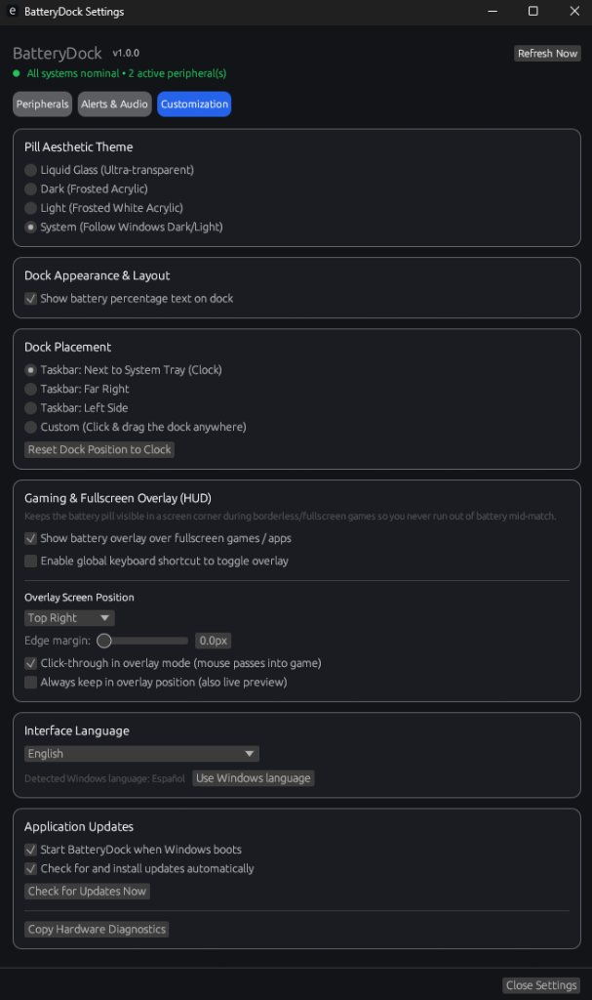

<div align="center">


# BatteryDock

**Заряд всех беспроводных устройств в одной лёгкой нативной капсуле на панели задач Windows. Без тяжёлых программ производителей.**

[](https://github.com/jorjanion/BatteryDock/stargazers)
[](https://github.com/jorjanion/BatteryDock/releases/latest)
[](https://github.com/jorjanion/BatteryDock/releases)
[](https://github.com/jorjanion/BatteryDock/actions)
[](../../LICENSE)
[](https://github.com/jorjanion/BatteryDock)
[](https://www.rust-lang.org/)

[Скачать v1.0.0](https://github.com/jorjanion/BatteryDock/releases/latest) · [Сообщить об ошибке](https://github.com/jorjanion/BatteryDock/issues/new) · [Запросить устройство](https://github.com/jorjanion/BatteryDock/issues/new?template=device-support.md) · [Список изменений](../../CHANGELOG.md)

<br />

<sub>
<a href="../../README.md">English</a> ·
<a href="README.es.md">Español</a> ·
<a href="README.fr.md">Français</a> ·
<a href="README.de.md">Deutsch</a> ·
<a href="README.pt-BR.md">Português</a> ·
<a href="README.it.md">Italiano</a> ·
<a href="README.nl.md">Nederlands</a> ·
<a href="README.pl.md">Polski</a> ·
<a href="README.sv.md">Svenska</a> ·
<a href="README.cs.md">Čeština</a> ·
<b>Русский</b> ·
<a href="README.uk.md">Українська</a> ·
<a href="README.tr.md">Türkçe</a> ·
<a href="README.ar.md">العربية</a> ·
<a href="README.hi.md">हिन्दी</a> ·
<a href="README.id.md">Bahasa Indonesia</a> ·
<a href="README.vi.md">Tiếng Việt</a> ·
<a href="README.ja.md">日本語</a> ·
<a href="README.ko.md">한국어</a> ·
<a href="README.zh-CN.md">简体中文</a> ·
<a href="README.zh-TW.md">繁體中文</a>
</sub>

</div>

---

Если вы пользуетесь беспроводной мышью одного бренда, гарнитурой другого и Bluetooth-наушниками или геймпадом, проверка заряда в Windows обычно требует держать в фоне несколько тяжёлых программ.

**BatteryDock** заменяет всё это одним нативным приложением на Rust (~4 МБ) прямо на панели задач Windows 10/11. Без Electron, телеметрии, аккаунтов и лишних фоновых служб.

---

## Скриншоты

<div align="center">
  <table>
    <tr>
      <td align="center" valign="middle" width="50%">
        <br /><br />
        <sub><b>Одно устройство</b>: Чёткая векторная иконка, цветной индикатор и процент заряда на панели задач.</sub>
      </td>
      <td align="center" valign="middle" width="50%">
        <br /><br />
        <sub><b>Несколько устройств сразу</b>: Меняйте порядок, переименовывайте или скрывайте ненужные устройства.</sub>
      </td>
    </tr>
  </table>
  <br />
  <table>
    <tr>
      <td align="center" valign="top" width="33%">
        <br />
        <sub><b>Устройства</b>: Прогноз времени работы, график заряда за 24 часа, свои имена и отдельные пороги уведомлений.</sub>
      </td>
      <td align="center" valign="top" width="33%">
        <br />
        <sub><b>Уведомления и звук</b>: Оповещения о низком, критическом и 100% заряде с проверкой звука.</sub>
      </td>
      <td align="center" valign="top" width="33%">
        <br />
        <sub><b>Настройка</b>: Темы Liquid Glass / Тёмная / Светлая / Системная, игровой HUD, горячие клавиши и 21 язык.</sub>
      </td>
    </tr>
  </table>
</div>

---

## Возможности

### Минималистичная панель на панели задач
- **4 темы оформления:** **Liquid Glass** (ультрапрозрачная), **Тёмная**, **Светлая** или **Системная** (автоматически подстраивается под тему Windows).
- **Ничего лишнего:** Левый клик открывает настройки, правый вызывает быстрое меню, а перетаскиванием панель можно разместить на любом мониторе.
- **Умное поведение:** Всегда остаётся поверх панели задач даже при открытом «Пуске» или «Поиске» и автоматически скрывается в полноэкранном видео и играх.
- **Гибкая настройка:** Меняйте порядок устройств в один клик, задавайте удобные имена, скрывайте устройства или отключайте отображение процентов.

### Игровой и полноэкранный оверлей (HUD)
- **Отключён по умолчанию**, чтобы не мешать при просмотре фильмов и YouTube.
- При включении BatteryDock автоматически появляется в углу экрана в полноэкранных играх без рамки.
- **Любая точка экрана:** 4 угла с настраиваемым отступом или свободная позиция X/Y (от 0% до 100%) с предпросмотром в реальном времени.
- **Режим Click-through:** Клики мыши проходят сквозь оверлей прямо в игру.
- **Глобальная горячая клавиша:** Назначьте любое сочетание (по умолчанию `Alt + B`), чтобы включать или скрывать HUD прямо в игре без Alt+Tab.

### Умная телеметрия и уведомления
- **История заряда за 24 часа:** На карточке каждого устройства отображается компактный график зарядки и разряда.
- **Прогноз автономности и сон:** Оценивает оставшееся время работы или зарядки и определяет спящий режим устройства.
- **Уведомления о низком, критическом и 100% заряде:** Общие или индивидуальные пороги, отключение звука для выбранных устройств, мягкий сигнал и нативные уведомления Windows.

### 21 встроенный язык
- При первом запуске автоматически определяет язык Windows и включает его (или английский по умолчанию).
- Подгружает системные шрифты Windows по требованию для чёткого отображения любых алфавитов.

---

## Поддерживаемые устройства

BatteryDock читает заряд напрямую через HID, WinRT и Bluetooth без софта от производителей.

| Категория | Протокол / Метод | Поддерживаемые примеры |
| :--- | :--- | :--- |
| **Logitech Wireless** | Direct HID++ 2.0 & G HUB IPC | Lightspeed headsets (G733, G535, G935, G435), mice (G PRO, Superlight, G502, MX Master), keyboards (G915) |
| **Razer Wireless** | Native Razer HyperSpeed HID | Viper, DeathAdder, Basilisk, Naga, Cobra, BlackWidow, Barracuda, BlackShark |
| **SteelSeries, Corsair & Glorious** | Native USB-HID | Arctis / Aerox / Rival, Corsair wireless mice & headsets, Glorious Model O / D |
| **HyperX & Astro Gaming** | Native Wireless Audio HID | HyperX Cloud II / III / Alpha / Flight / Stinger Wireless, Astro A50 / A30 |
| **Bluetooth Classic & BLE** | Windows PnP (`DEVPKEY_Bluetooth_Battery`) & BLE GATT | Sony WH/WF series (WH-1000XM4/XM5, WH-CH720N), JBL (Tune 770NC, Live), Bose, Sennheiser, AirPods, BT mice & keyboards |
| **Xbox Controllers** | XInput & Windows Gaming Input (WinRT) | Xbox Series X/S, Xbox One, Xbox Elite Series 2 |
| **PlayStation Controllers** | Direct Sony USB & Bluetooth HID | DualSense, DualSense Edge, DualShock 4 (USB, BT, & Wireless Adapter) |
| **Nintendo Controllers** | Direct Nintendo HID | Switch Pro Controller, Joy-Con L/R |

---

## Скачивание и установка

Скачайте актуальную версию на **[странице Releases](https://github.com/jorjanion/BatteryDock/releases/latest)**:

1. Скачайте **`BatteryDock-Setup-v1.0.0.exe`** (установщик) или **`BatteryDock-Windows-Portable.zip`** (портативная версия).
2. Запустите и при желании включите автозапуск с Windows в настройках.
3. Панель появится рядом с часами. Встроенная проверка обновлений с GitHub держит приложение актуальным.

### Предупреждение Windows SmartScreen
Поскольку это бесплатный проект с открытым исходным кодом без платного сертификата подписи, при первом запуске Windows SmartScreen может показать предупреждение. Нажмите **Подробнее** и **Выполнить в любом случае**. Все релизы собираются публично в [`.github/workflows/release.yml`](../../.github/workflows/release.yml).

---

## Конфигурация

Настройки хранятся в `%APPDATA%\jorjanion\BatteryDock\config\config.toml` (история в `history.toml`) и применяются мгновенно без перезапуска.

---

## Сборка из исходного кода

Требования: Windows 10/11 и [Rust](https://rustup.rs/) (стабильный MSVC).

```powershell
git clone https://github.com/jorjanion/BatteryDock.git
cd BatteryDock
cargo test --locked
cargo build --release --locked
.\target\release\battery-dock.exe
```

---

## Участие, Issues и Pull Requests

BatteryDock развивается открыто вместе с сообществом. Сообщения об ошибках, переводы, запросы устройств и PR всегда приветствуются.

- **Устройство не отображается?** Создайте **[запрос поддержки устройства](https://github.com/jorjanion/BatteryDock/issues/new?template=device-support.md)**. Откройте **Настройки > Настройка > Копировать диагностику устройств** и вставьте анонимный отчёт прямо в issue.
- **Нашли баг или есть идея?** Создайте **[Issue](https://github.com/jorjanion/BatteryDock/issues)** с версией Windows и шагами воспроизведения.
- **Хотите добавить бренд или функцию?** Pull Requests приветствуются. Запустите `cargo test --locked` и `cargo clippy --locked` перед отправкой.

---

## Лицензия

Лицензия MIT. Подробнее в [LICENSE](../../LICENSE).
