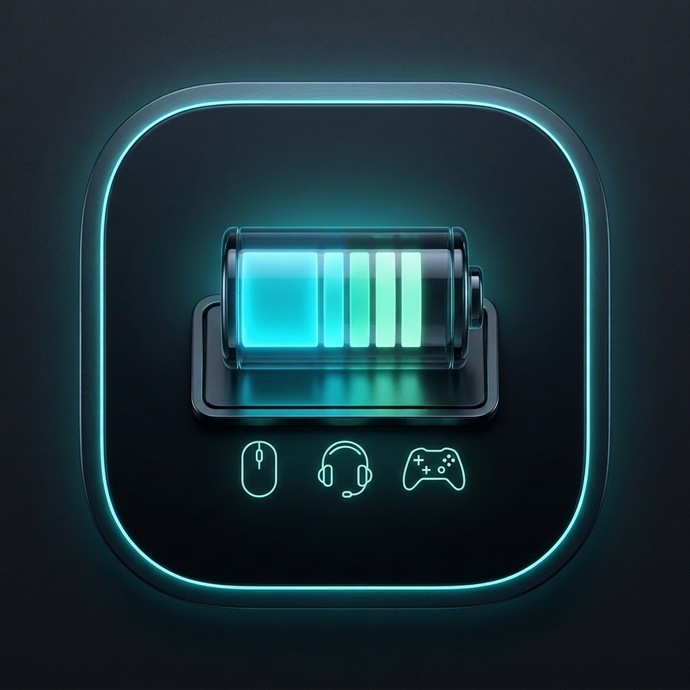
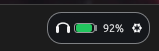
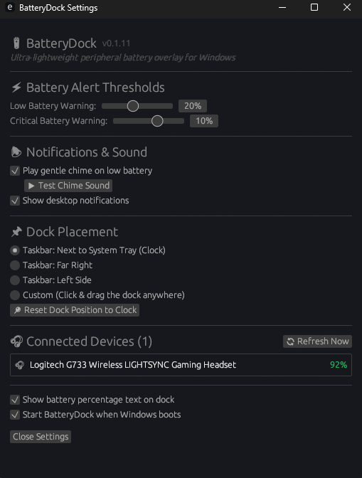

<div align="center">



# BatteryDock

**Минималистичный нативный индикатор заряда на Rust прямо в панели задач Windows 10/11 — без тяжёлого ПО производителей.**

[](https://github.com/jorjanion/BatteryDock/stargazers)
[](https://github.com/jorjanion/BatteryDock/releases/latest)
[](https://github.com/jorjanion/BatteryDock/releases)
[](https://github.com/jorjanion/BatteryDock/actions)
[](../../LICENSE)
[](https://github.com/jorjanion/BatteryDock)
[](https://www.rust-lang.org/)

[Скачать установщик](https://github.com/jorjanion/BatteryDock/releases/latest) · [Сообщить об ошибке](https://github.com/jorjanion/BatteryDock/issues) · [Запросить поддержку устройства](https://github.com/jorjanion/BatteryDock/issues/new?template=device-support.md)

<br />

<sub>
<a href="../../README.md">English</a> ·
<a href="README.es.md">Español</a> ·
<a href="README.fr.md">Français</a> ·
<a href="README.de.md">Deutsch</a> ·
<a href="README.pt-BR.md">Português</a> ·
<a href="README.it.md">Italiano</a> ·
<a href="README.nl.md">Nederlands</a> ·
<a href="README.pl.md">Polski</a> ·
<a href="README.sv.md">Svenska</a> ·
<a href="README.cs.md">Čeština</a> ·
<b>Русский</b> ·
<a href="README.uk.md">Українська</a> ·
<a href="README.tr.md">Türkçe</a> ·
<a href="README.ar.md">العربية</a> ·
<a href="README.hi.md">हिन्दी</a> ·
<a href="README.id.md">Bahasa Indonesia</a> ·
<a href="README.vi.md">Tiếng Việt</a> ·
<a href="README.ja.md">日本語</a> ·
<a href="README.ko.md">한국어</a> ·
<a href="README.zh-CN.md">简体中文</a> ·
<a href="README.zh-TW.md">繁體中文</a>
</sub>

</div>

---

## 📸 Превью

<div align="center">
  <table>
    <tr>
      <td align="center" valign="middle" width="42%">
        <br /><br />
        <sub><b>Капсула в панели задач</b> — Встроена прямо в панель задач Windows, с DPI-масштабированием на каждый монитор и иконкой зарядки ⚡.</sub>
      </td>
      <td align="center" valign="middle" width="58%">
        <br />
        <sub><b>Отдельные настройки</b> — Пороги уведомлений, тест звука, выбор позиции и список подключённых устройств.</sub>
      </td>
    </tr>
  </table>
</div>

---

## ⚡ Почему BatteryDock?

Большинство беспроводных устройств скрывают уровень заряда внутри громоздких фирменных утилит с десятками фоновых служб. **BatteryDock** выводит всё в компактную капсулу на панели задач:

- **Никакого лишнего ПО:** Один нативный исполняемый файл на Rust размером **~4 МБ** (без Electron и телеметрии, ~77 МБ приватной памяти в Windows 11).
- **Прямое чтение устройств:** Опрашивает **Logitech HID++ 2.0**, **Windows Bluetooth / BLE GATT**, **XInput** и **Sony DualSense / DualShock 4 HID** напрямую — устройства Logitech работают даже без открытого G HUB (поддерживается и G HUB IPC).
- **Умный полноэкранный режим:** Автоматически скрывается в полноэкранных играх, видео или при автоскрытии панели задач, но остаётся видимым при нажатии клавиши `Win`, открытии Пуск/Поиска/Виджетов или кликах по рабочему столу.
- **Индикатор зарядки в реальном времени:** Подсвечивает заряжаемое устройство **голубым** цветом со значком **молнии ⚡**.
- **Надёжные фоновые оповещения:** Звуковой сигнал и уведомления Windows срабатывают из фонового движка даже в полноэкранных играх.

---

## 📥 Скачивание и установка

Загрузите последнюю версию со **[страницы Releases](https://github.com/jorjanion/BatteryDock/releases/latest)**:

1. Скачайте **`BatteryDock-Setup-v0.1.11.exe`** (~4,4 МБ) — или `BatteryDock-Windows-Portable.zip` для портативного запуска.
2. Запустите установщик и при желании отметьте **"Start BatteryDock when Windows boots"**.
3. Капсула появится на панели задач слева от часов.

### 🛡️ Примечание о Windows SmartScreen
Поскольку BatteryDock — бесплатный open-source проект без платного EV-сертификата подписи, SmartScreen при первом запуске может показать *"Система Windows защитила ваш компьютер"* (**Подробнее → Выполнить в любом случае**).
- Каждый билд собирается открыто на серверах GitHub Actions в [`.github/workflows/release.yml`](../../.github/workflows/release.yml).
- Вы можете проверить исходный код и [собрать проект самостоятельно](#build-from-source) меньше чем за минуту.

---

## 🎧 Поддерживаемые устройства

| Категория | Протокол / Источник | Примеры и примечания |
| :--- | :--- | :--- |
| **Беспроводные Logitech** | Прямой HID++ 2.0 (`0x1004` / `0x1000`) & G HUB IPC | Гарнитуры Lightspeed (G733, G535, G935), мыши (G PRO, Superlight, G502), клавиатуры |
| **Bluetooth & BLE** | Windows WinRT PnP + BLE GATT (`0x180F` / `0x2A19`) | Наушники (Sony WH/WF, Bose, AirPods), BT-мыши и клавиатуры |
| **Геймпады Xbox** | Windows `XInput` | Xbox Wireless Controllers (Series X\|S, One, 360), включая зарядку по кабелю |
| **PlayStation** | Sony HID (`VID 0x054C`) USB и Bluetooth | DualSense и DualShock 4 (несколько контроллеров + статус зарядки) |

**Нет вашего бренда (Razer, Corsair, SteelSeries, Keychron и т.д.)?**
👉 **[Открыть запрос на поддержку устройства](https://github.com/jorjanion/BatteryDock/issues/new?template=device-support.md)** — Pull Request'ы также приветствуются!

---

## 🎯 Управление и индикаторы

### Цвета статуса
- **Зелёный:** Нормальный заряд (выше низкого порога)
- **Янтарный:** Низкий заряд (по умолчанию `20%`)
- **Красный (пульсирующий):** Критический заряд (по умолчанию `10%`)
- **Голубой + ⚡:** Устройство заряжается

### Управление
- **Левый клик** по капсуле или **`⚙`** (либо иконке в трее): Открывает **BatteryDock Settings** (`BatteryDock.exe --settings`).
- **Правый клик** по капсуле или иконке в трее: Нативное меню (**Settings**, **Refresh Devices**, **Reset to Taskbar Clock**, **Restart BatteryDock**, **Exit BatteryDock**).
- **Перетаскивание (> 5px):** Переместите в любое место (включая другие мониторы); правый клик → **Reset to Taskbar Clock** возвращает к часам.

---

## ⚙️ Конфигурация

Настройки сохраняются в `%APPDATA%\jorjanion\BatteryDock\config\config.toml`:

```toml
low_battery_threshold = 20
critical_battery_threshold = 10
audio_alert_enabled = true
visual_alert_enabled = true
position_mode = "TaskbarLeftOfTray" # TaskbarLeftOfTray | TaskbarRight | TaskbarLeft | Custom
custom_pos_x = 0.0
custom_pos_y = 0.0
snap_to_taskbar = true
start_with_windows = false
poll_interval_secs = 15
show_percentage_text = true
compact_mode = false
```

---

<a id="build-from-source"></a>

## 🛠️ Сборка из исходников

### Требования
- [Rust toolchain](https://rustup.rs/) (stable)
- Windows 10 или Windows 11 (MSVC)

### Команды

```powershell
git clone https://github.com/jorjanion/BatteryDock.git
cd BatteryDock

# Проверка форматирования, clippy и тестов
cargo fmt --check
cargo clippy --all-targets -- -D warnings
cargo test --locked

# Сборка оптимизированного release-файла
cargo build --release --locked
```

Исполняемый файл появится в `target\release\battery-dock.exe` (флаг `--settings` / `-s` открывает настройки).

---

## 📄 Лицензия

Распространяется по **лицензии MIT**. Подробнее в [LICENSE](../../LICENSE).

<div align="center">

**Если BatteryDock оказался полезен, поставьте репозиторию ⭐!**

</div>
