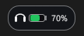

<div align="center">


# BatteryDock

**将所有无线外设电量收纳在 Windows 任务栏的一个轻量原生胶囊中，告别臃肿的厂商驱动套件。**

[](https://github.com/jorjanion/BatteryDock/stargazers)
[](https://github.com/jorjanion/BatteryDock/releases/latest)
[](https://github.com/jorjanion/BatteryDock/releases)
[](https://github.com/jorjanion/BatteryDock/actions)
[](../../LICENSE)
[](https://github.com/jorjanion/BatteryDock)
[](https://www.rust-lang.org/)

[下载 v1.0.0](https://github.com/jorjanion/BatteryDock/releases/latest) · [报告问题](https://github.com/jorjanion/BatteryDock/issues/new) · [请求设备支持](https://github.com/jorjanion/BatteryDock/issues/new?template=device-support.md) · [更新日志](../../CHANGELOG.md)

<br />

<sub>
<a href="../../README.md">English</a> ·
<a href="README.es.md">Español</a> ·
<a href="README.fr.md">Français</a> ·
<a href="README.de.md">Deutsch</a> ·
<a href="README.pt-BR.md">Português</a> ·
<a href="README.it.md">Italiano</a> ·
<a href="README.nl.md">Nederlands</a> ·
<a href="README.pl.md">Polski</a> ·
<a href="README.sv.md">Svenska</a> ·
<a href="README.cs.md">Čeština</a> ·
<a href="README.ru.md">Русский</a> ·
<a href="README.uk.md">Українська</a> ·
<a href="README.tr.md">Türkçe</a> ·
<a href="README.ar.md">العربية</a> ·
<a href="README.hi.md">हिन्दी</a> ·
<a href="README.id.md">Bahasa Indonesia</a> ·
<a href="README.vi.md">Tiếng Việt</a> ·
<a href="README.ja.md">日本語</a> ·
<a href="README.ko.md">한국어</a> ·
<b>简体中文</b> ·
<a href="README.zh-TW.md">繁體中文</a>
</sub>

</div>

---

如果你同时使用不同品牌的无线鼠标、耳机和蓝牙手柄，在 Windows 上查看电量通常意味着要在后台挂着好几个臃肿的厂商软件。

**BatteryDock** 用一个仅约 4 MB 的原生 Rust 应用取代它们，安静地嵌在 Windows 10/11 任务栏上。无 Electron，无遥测，无需登录账号。

---

## 界面预览

<div align="center">
  <table>
    <tr>
      <td align="center" valign="middle" width="50%">
        <br /><br />
        <sub><b>单个外设</b>: 清晰矢量图标、彩色电量条与百分比直接显示在任务栏上。</sub>
      </td>
      <td align="center" valign="middle" width="50%">
        <br /><br />
        <sub><b>多外设并排</b>: 自由排序、自定义别名或隐藏不想显示的设备。</sub>
      </td>
    </tr>
  </table>
  <br />
  <table>
    <tr>
      <td align="center" valign="top" width="33%">
        <br />
        <sub><b>外设面板</b>: 实时续航估算、24 小时电量趋势图、别名及单设备警报。</sub>
      </td>
      <td align="center" valign="top" width="33%">
        <br />
        <sub><b>警报与音效</b>: 低电量、极低电量及 100% 充满提醒，支持提示音试听。</sub>
      </td>
      <td align="center" valign="top" width="33%">
        <br />
        <sub><b>个性化设置</b>: Liquid Glass / 深色 / 浅色 / 跟随系统主题、游戏 HUD 悬浮窗、快捷键与 21 种语言。</sub>
      </td>
    </tr>
  </table>
</div>

---

## 核心功能

### 极简任务栏电量条
- **4 种视觉主题:** 可选 **Liquid Glass** (超透明玻璃)、**深色**、**浅色** 或 **跟随系统** (自动匹配 Windows 主题)。
- **简洁交互:** 左键点击电量条打开设置，右键打开快捷菜单，也可直接拖动到任意显示器。
- **智能任务栏适配:** 打开开始菜单、搜索或小组件时依然稳居前端，全屏看视频或玩游戏时自动隐藏。
- **自定义布局:** 一键调整设备排序、设置别名、隐藏单个设备，或开关百分比文字。

### 可选游戏与全屏悬浮窗 (HUD)
- **默认关闭**，确保全屏观影和刷视频不受打扰。
- 开启后，在无边框全屏游戏中会自动显示在屏幕角落，避免团战中途突然没电。
- **任意摆放:** 支持 4 个角落预设 (可调边距) 或自由位置 X/Y (0% 到 100%)，带实时预览。
- **鼠标穿透 (Click-through):** 点击直接穿透到游戏画面，完全不干扰操作。
- **全局快捷键:** 自定义任意快捷键 (默认 `Alt + B`)，无需 Alt+Tab 即可在游戏内随时呼出或隐藏。

### 智能遥测与提醒
- **24 小时电量曲线:** 每个设备卡片均绘制轻量级本地充放电趋势图。
- **续航与休眠识别:** 估算剩余使用时间或充满所需时间，并识别设备休眠状态。
- **低电量、极低电量与 100% 充满提醒:** 支持全局或单设备阈值、单独静音、柔和提示音与 Windows 桌面通知。

### 内置 21 种语言
- 首次启动自动识别 Windows 系统语言并切换 (暂未支持的语言默认英文)。
- 按需加载 Windows 原生系统字体，确保各种文字清晰无方块。

---

## 支持硬件

BatteryDock 通过 HID、WinRT 和蓝牙直接读取硬件电量，无需后台常驻厂商软件。

| 类别 | 协议 / 方式 | 支持示例 |
| :--- | :--- | :--- |
| **Logitech Wireless** | Direct HID++ 2.0 & G HUB IPC | Lightspeed headsets (G733, G535, G935, G435), mice (G PRO, Superlight, G502, MX Master), keyboards (G915) |
| **Razer Wireless** | Native Razer HyperSpeed HID | Viper, DeathAdder, Basilisk, Naga, Cobra, BlackWidow, Barracuda, BlackShark |
| **SteelSeries, Corsair & Glorious** | Native USB-HID | Arctis / Aerox / Rival, Corsair wireless mice & headsets, Glorious Model O / D |
| **HyperX & Astro Gaming** | Native Wireless Audio HID | HyperX Cloud II / III / Alpha / Flight / Stinger Wireless, Astro A50 / A30 |
| **Bluetooth Classic & BLE** | Windows PnP (`DEVPKEY_Bluetooth_Battery`) & BLE GATT | Sony WH/WF series (WH-1000XM4/XM5, WH-CH720N), JBL (Tune 770NC, Live), Bose, Sennheiser, AirPods, BT mice & keyboards |
| **Xbox Controllers** | XInput & Windows Gaming Input (WinRT) | Xbox Series X/S, Xbox One, Xbox Elite Series 2 |
| **PlayStation Controllers** | Direct Sony USB & Bluetooth HID | DualSense, DualSense Edge, DualShock 4 (USB, BT, & Wireless Adapter) |
| **Nintendo Controllers** | Direct Nintendo HID | Switch Pro Controller, Joy-Con L/R |

---

## 下载与安装

前往 **[Releases 页面](https://github.com/jorjanion/BatteryDock/releases/latest)** 获取最新版本:

1. 下载 **`BatteryDock-Setup-v1.0.0.exe`** (安装版) 或 **`BatteryDock-Windows-Portable.zip`** (免安装便携版)。
2. 运行后可在设置中按需开启开机自启。
3. 电量条将出现在任务栏时钟旁，内置 GitHub 自动更新检查。

### Windows SmartScreen 说明
由于 BatteryDock 是免费开源项目且尚未购买商业代码签名证书，首次运行可能弹出 SmartScreen 提示。点击 **更多信息** 然后选择 **仍要运行**。所有发布包均通过 [`.github/workflows/release.yml`](../../.github/workflows/release.yml) 公开构建。

---

## 配置说明

配置文件保存在 `%APPDATA%\jorjanion\BatteryDock\config\config.toml` (趋势历史在 `history.toml`)，修改即时生效无需重启。

---

## 从源码构建

环境要求: Windows 10/11 与 [Rust](https://rustup.rs/) (稳定版 MSVC)。

```powershell
git clone https://github.com/jorjanion/BatteryDock.git
cd BatteryDock
cargo test --locked
cargo build --release --locked
.\target\release\battery-dock.exe
```

---

## 参与贡献、Issue 与 Pull Request

BatteryDock 是社区驱动的开源项目，非常欢迎提交 Bug 报告、翻译、新设备适配请求与 PR。

- **未识别到你的设备？** 提交 **[设备支持请求](https://github.com/jorjanion/BatteryDock/issues/new?template=device-support.md)**。在 **设置 > 个性化 > 复制硬件诊断信息** 一键复制匿名报告并粘贴到 Issue 即可。
- **发现 Bug 或有新想法？** 欢迎提交 **[Issue](https://github.com/jorjanion/BatteryDock/issues)**，附上 Windows 版本和复现步骤。
- **想贡献代码？** 欢迎提交 Pull Request，提交前请运行 `cargo test --locked` 和 `cargo clippy --locked`。

---

## 开源协议

MIT 协议，详见 [LICENSE](../../LICENSE)。
